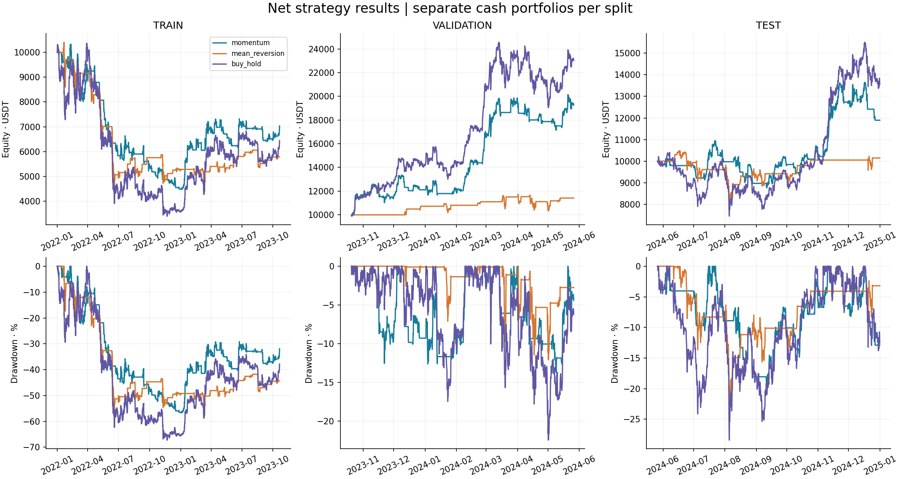

# QUANTLAB
### Quantitative Trading Research & Backtesting Platform

**Python | Pandas | NumPy | SciPy | Matplotlib | Time Series | Statistics | Backtesting**

Plataforma offline para investigar estrategias sistemáticas simples, con costos, riesgo, regímenes de mercado y evaluación fuera de muestra. Incluye datos históricos reales, un motor contable de efectivo/unidades, 33 pruebas cuantitativas y un informe reproducible.

**Pregunta:** ¿Las estrategias simples muestran comportamientos interesantes en BTC después de considerar costos, riesgo y evaluación fuera de muestra? El objetivo es evaluar evidencia, no demostrar rentabilidad.



## Resultados de ejemplo: fuera de muestra

BTC/USDT, 4 horas; del 26/05/2024 16:00 UTC al 01/01/2025 00:00 UTC (exclusivo). Capital inicial: 10.000 USDT; comisión supuesta: 0,10% por lado; deslizamiento: 0%.

| Estrategia | Retorno neto | Drawdown máximo | Exposición | Operaciones completas |
| --- | ---: | ---: | ---: | ---: |
| Momentum MA 10/50 | 18,95% | −19,90% | 54,86% | 16 |
| Reversión a la media | 1,43% | −26,43% | 24,77% | 12 |
| Comprar y mantener | 35,65% | −28,40% | 100% | 1 |

Ambas estrategias quedaron por debajo del benchmark en retorno. Momentum tuvo menor drawdown, pero eso no establece una ventaja estadística. En entrenamiento las tres alternativas perdieron valor. Ver el [informe completo](reports/quant_report.md), que incluye los tres períodos y ambos escenarios de costos.

## Instalación y ejecución

Python 3.11 o superior (verificado en Python 3.12). Desde la carpeta raíz del proyecto:

```bash
python -m venv .venv
# Linux/macOS:
source .venv/bin/activate
# Windows PowerShell, en lugar de la línea anterior:
# .venv\Scripts\Activate.ps1
python -m pip install -r requirements.txt
python -m src.run_analysis
python -m pytest -q
```

El CSV histórico está incluido: el análisis no necesita conexión. El comando genera métricas CSV, registros de efectivo/unidades, órdenes, operaciones, selección de parámetros, tres figuras y `reports/quant_report.md`.

Para volver a descargar los 36 archivos históricos públicos, sin claves:

```bash
python -m src.data.download --start 2022-01 --end 2024-12
```

Si no hay red y no se cuenta con el CSV, usar **explícitamente** la simulación de ingeniería:

```bash
python -m src.run_analysis --synthetic --output reports_synthetic
```

Sus resultados se etiquetan SYNTHETIC; no representan BTC histórico. No existe sustitución silenciosa del dataset.

Para analizar otra comisión o deslizamiento:

```bash
python -m src.run_analysis --cost 0.002 --slippage 0.0005 --output reports_cost_study
```

Cada ejecución vuelve a aplicar el protocolo declarado. Comparar repetidamente resultados de test para elegir parámetros o costos transforma ese test en datos de desarrollo; se necesitaría otro período verdaderamente reservado.

## Datos y calidad

6.576 velas BTC/USDT de 4 horas, desde 2022-01-01 hasta 2025-01-01 exclusivo. Fuente: [archivos públicos de Binance](https://github.com/binance/binance-public-data). `data/raw/btcusdt_4h.json` conserva URLs y SHA-256 de los archivos originales; el informe registra el hash del CSV analizado. Timestamps UTC representan la apertura de la vela. Volumen en BTC; precios en USDT.

Se ordenan las filas y se rechazan duplicados, huecos, valores ausentes/no finitos, precios no positivos y OHLC inconsistentes. No se rellenan cotizaciones artificialmente. El parser admite timestamps en milisegundos y microsegundos.

## Estrategias

- **Momentum:** media rápida mayor que lenta → mantener posición larga; de lo contrario efectivo. Explora persistencia de tendencias.
- **Reversión:** z-score de 42 velas menor que −2 → entrar; al recuperar 0 → salir. Explora reversión de desviaciones.
- **Benchmark:** comprar en la primera apertura y liquidar al cierre final de cada período.

## Metodología y prevención de sesgos

División cronológica 60/20/20, sin mezclar observaciones. Nueve candidatos de momentum (rápida 10/20/30; lenta 50/100/150) se evalúan en entrenamiento y validación. Se elige por Sharpe neto de validación, con desempate determinista. La función de selección no recibe el test. Reversión usa parámetros fijos.

La selección queda registrada antes de calcular resultados fuera de muestra. Los indicadores pueden utilizar historia anterior a cada división. Cada cartera comienza en efectivo y la primera señal ejecutable corresponde a la apertura de la segunda vela de su división. No se arrastran posiciones ni P&L entre períodos.

**Ejecución:** señal con cierre t → apertura t+1. Un salto hasta la apertura pertenece a quien ya tenía el activo; no se lo asigna al comprador nuevo. Se liquidan posiciones en el último cierre por convención fijada de antemano. La comisión afecta compra y venta; el deslizamiento modifica el precio en dirección desfavorable. No hay apalancamiento, cortos ni ejecución real.

## Métricas, riesgo y regímenes

Retorno total, CAGR cuando el período alcanza un año, volatilidad anualizada, Sharpe con tasa libre de riesgo cero, drawdown incluyendo capital inicial, Calmar cuando corresponde, tasa de aciertos, operaciones, retorno medio/mejor/peor, exposición y profit factor de P&L monetario.

La anualización usa 365,25 × 6 barras/año. Volatilidad y Sharpe dependen de supuestos de escalado temporal; no constituyen pruebas de significancia. VaR y expected shortfall históricos al 95% describen pérdidas por vela, no máximos posibles. Se informa también el peor intervalo móvil de 24 horas.

Regímenes: precio sobre/bajo media de 180 velas, combinado con volatilidad de 42 velas sobre/bajo su mediana expansiva. Etiquetas retrasadas una vela; sin umbrales calculados con información futura. Las estadísticas condicionadas por régimen incluyen su benchmark.

## Arquitectura

| Ruta | Responsabilidad |
| --- | --- |
| `src/config.py` | Supuestos de frecuencia y costos |
| `src/data/` | Descarga, procedencia, muestra sintética, validación |
| `src/features/` | Retornos, estadística descriptiva e indicadores |
| `src/strategies/` | Interfaz común, momentum y reversión |
| `src/backtest/` | Ejecución, costos y contabilidad |
| `src/analysis/` | Métricas, drawdown, riesgo y regímenes |
| `src/experiments/` | División temporal y nueve candidatos |
| `src/reporting/` | Protocolo, tablas, figuras e informe |
| `src/run_analysis.py` | Entrada CLI |
| `notebooks/research.ipynb` | Investigación guiada con resultados ejecutados |
| `tests/` | Ejemplos matemáticos y controles de causalidad |
| `data/raw/`, `data/processed/` | Dataset y variables derivadas |
| `reports/` | Informe y evidencias auditables |

## Notebook

`notebooks/research.ipynb` incluye salidas ejecutadas. En VS Code con soporte Jupyter, seleccionar el entorno instalado y ejecutar sus celdas. También puede ejecutarse sin interfaz:

```bash
python scripts/execute_notebook.py
# En entornos que impiden abrir sockets, ejecutar las mismas celdas dentro de IPython:
python scripts/execute_notebook.py --in-process
```

El notebook demuestra estrategias en entrenamiento y consulta las salidas congeladas de test; no vuelve a seleccionar parámetros. Si cambian los datos o supuestos, regenerar primero el informe y mantener trazabilidad del nuevo experimento.

## Pruebas

```bash
python -m pytest -q
```

33 casos: retornos conocidos, alineación temporal y gaps, comisión/deslizamiento exactos, liquidación final, benchmark, identidad contable, drawdown inicial, métricas de ejemplo, señales, invariancia ante datos futuros, regímenes causales, división temporal, selección, validación, timestamps ms/us y fallback reproducible. Ver [validación realizada](docs/VALIDATION.md).

## Limitaciones

Una sola moneda superviviente y un único exchange introducen sesgo de selección. No se modelan spreads variables, profundidad, liquidez, latencia, tamaños mínimos, impuestos ni riesgo de USDT. Los drawdowns usan cierres y pueden subestimar pérdidas intravela. Nueve comparaciones de validación generan riesgo de sobreajuste. No hay pruebas de significancia, corrección por múltiples comparaciones ni walk-forward; un único test no demuestra generalización. Monte Carlo queda fuera de este MVP.

**For educational and research purposes. Historical performance does not imply future results.**
