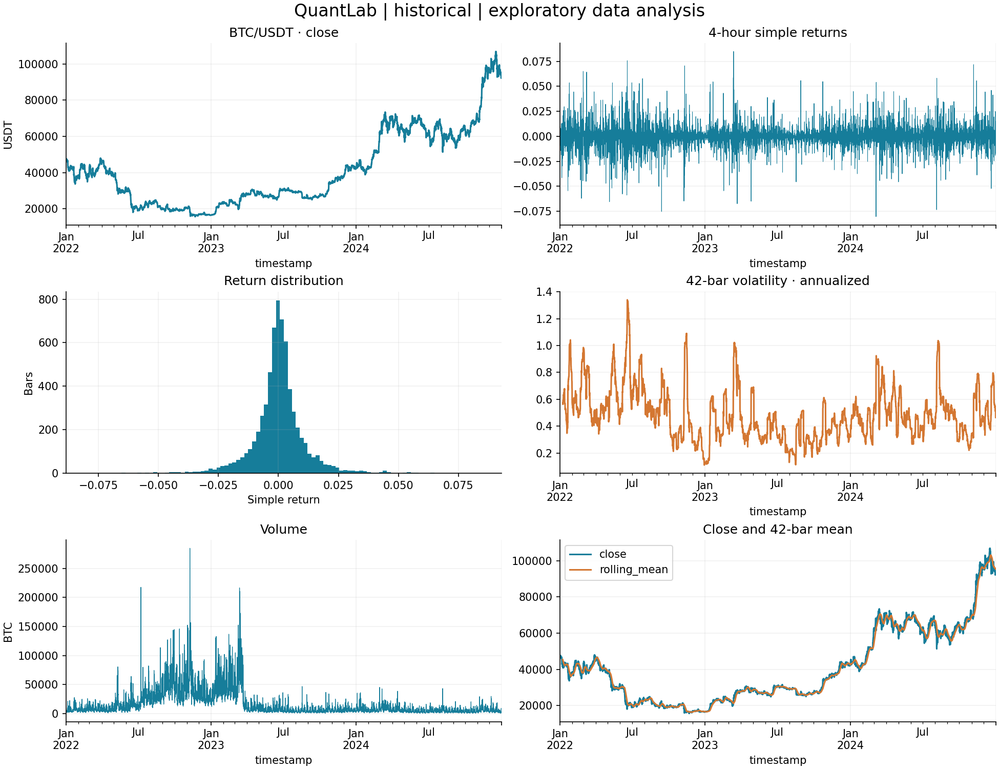
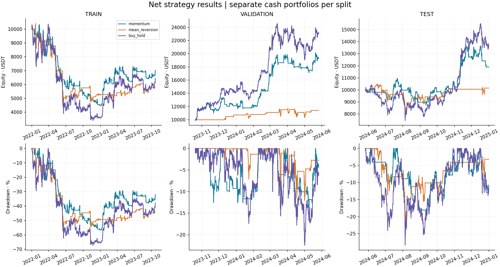
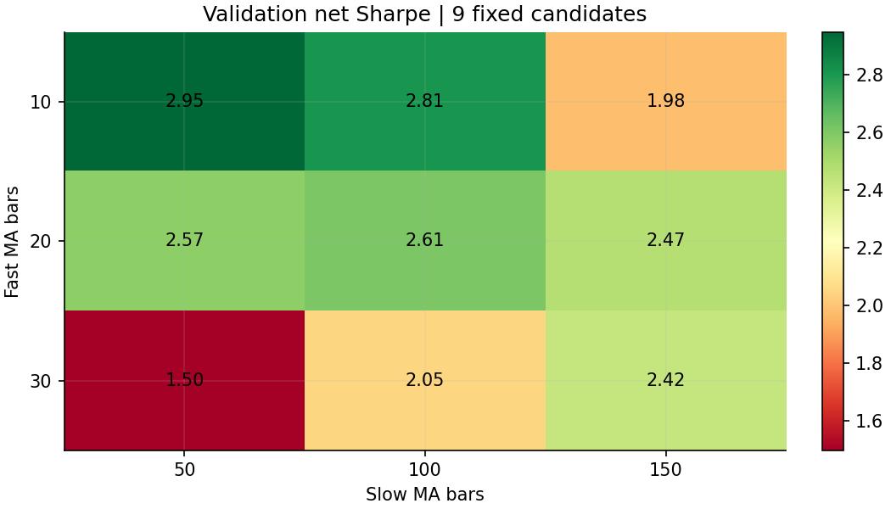

# QuantLab — Research report

## 1. Dataset and provenance

**historical**. Source: Binance public spot archives. BTC/USDT (USDT is not USD). Frequency: 4h.
Coverage: 2022-01-01 00:00:00+00:00 through 2025-01-01 00:00:00+00:00 (exclusive).
Timestamp denotes candle OPEN. Data SHA-256: `a13e78bab409c5bc5eaac45804d2a82235a2f70aa7fb4c6b3b81b86cb94cd923`.
Public archive schema: https://github.com/binance/binance-public-data .
Checksums and exact archive URLs are recorded in the dataset JSON sidecar.
If the dataset is synthetic, every observation below is a software demonstration, not a BTC finding.

## 2. Data quality

| index | value |
| --- | --- |
| rows | 6576 |
| duplicates | 0 |
| missing_bars | 0 |
| missing_values | 0 |
| input_sorted | True |
| frequency | 4h |
| policy | sort; fail on duplicates, gaps or missing values |
| sha256 | a13e78bab409c5bc5eaac45804d2a82235a2f70aa7fb4c6b3b81b86cb94cd923 |

Missing prices are not forward filled; incomplete data aborts analysis.

## 3. Return and volume statistics

Simple return: close[t]/close[t-1] - 1. Log return: log(close[t]/close[t-1]).
First undefined observation is excluded from descriptive statistics. Excess kurtosis uses the normal=0 convention.
Rolling mean/std/volatility use 42 bars (7 days), std uses ddof=1.

| index | value |
| --- | --- |
| mean | 0.00016791 |
| median | 0.00015855 |
| std | 0.011186 |
| skewness | 0.037387 |
| excess_kurtosis | 7.0188 |
| q0.01 | -0.032463 |
| q0.05 | -0.017348 |
| q0.25 | -0.004058 |
| q0.75 | 0.0043623 |
| q0.95 | 0.017192 |
| q0.99 | 0.034378 |

| index | value |
| --- | --- |
| count | 6576 |
| mean | 15661 |
| std | 20977 |
| min | 526.41 |
| 25% | 3746.2 |
| 50% | 7022.8 |
| 75% | 19133 |
| max | 2.8471e+05 |

## 4. Strategies and hypotheses

Momentum: MA(10) > MA(50) means long, otherwise cash. Hypothesis: trends may persist.
Mean reversion: 42-bar rolling z-score below -2 enters long, z-score >=0 exits. Hypothesis: deviations may partially revert.
Zero variance/insufficient history yields cash. Both strategies use completed candles only.
Buy-and-hold is the mandatory benchmark and buys at each split's first open.

## 5. Backtest methodology and execution

Signals at close t execute at open t+1. The engine tracks cash and asset units; no leverage, shorting or rebalancing while holding.
Existing units receive overnight/open gaps; newly bought units receive only subsequent moves.
Each split starts with 10,000.00 USDT cash; strategy first bar is cash because the local signal is shifted.
Past data warms indicators and signal state, but holdings are not carried across splits. No future prices warm indicators.
All open positions liquidate at the final candle close, a predetermined endpoint convention; this includes exit costs.
The final signal is ignored. Trades include these terminal exits, flagged in the ledger. Marks use candle close.
Ledger/order timestamps identify candle OPEN even for a terminal_close execution; that fill occurs at that candle end.
Exposure is the fraction of bars held from open through close, before terminal liquidation, not a capital-weighted risk measure.

## 6. Transaction costs and benchmark

Fee: 0.100% of executed notional on EACH side. Slippage: 0.000% adverse price adjustment on EACH side.
A buy uses units = cash / (open × (1+slippage) × (1+fee)); a sell receives units × open × (1-slippage) × (1-fee).
Frictionless means both fee and slippage are zero. Benchmark bears entry and terminal exit costs too.

## 7. Chronological train / validation / held-out test

| split | start_open_utc | last_open_utc | end_exclusive_utc | bars |
| --- | --- | --- | --- | --- |
| train | 2022-01-01 00:00:00+00:00 | 2023-10-20 08:00:00+00:00 | 2023-10-20 12:00:00+00:00 | 3945 |
| validation | 2023-10-20 12:00:00+00:00 | 2024-05-26 12:00:00+00:00 | 2024-05-26 16:00:00+00:00 | 1315 |
| test | 2024-05-26 16:00:00+00:00 | 2024-12-31 20:00:00+00:00 | 2025-01-01 00:00:00+00:00 | 1316 |

Nine momentum configurations: fast ∈ {10,20,30}, slow ∈ {50,100,150}. Train and validation results are recorded.
Select the highest validation NET Sharpe, ties use lower fast then slow. No test input enters the selection function.
Selected configuration and data hash are frozen in selection.json before test evaluation.
Mean-reversion parameters are fixed in advance. Test runs once per declared cost scenario, without subsequent selection.
Training results for the selected model are retrospective in-sample descriptions, not unbiased estimates.
Full-period exploration is descriptive after selection. Reusing this test to redesign a strategy would invalidate its held-out status.

## 8. Performance metrics (net)

Ratios/returns are decimals; 0.10 means 10%. Annualization: 2191.5 four-hour bars/year (365.25-day crypto calendar).
Annualized return and Calmar are omitted when a split is shorter than one year. Volatility and Sharpe are annualized descriptive estimates;
Sharpe assumes zero risk-free return and square-root time scaling, which can mislead with autocorrelation or changing variance.
Drawdown includes initial capital as a possible peak. Profit factor uses closed-trade cash P&L; absent losses yields N/A.

| split | strategy | total_return | annualized_return | annualized_volatility | sharpe | max_drawdown | calmar | win_rate | trades | average_trade | best_trade | worst_trade | exposure | profit_factor |
| --- | --- | --- | --- | --- | --- | --- | --- | --- | --- | --- | --- | --- | --- | --- |
| train | momentum | -0.29669 | -0.17759 | 0.33211 | -0.42231 | -0.56711 | -0.31315 | 0.23333 | 60 | -0.0037619 | 0.38265 | -0.092269 | 0.44436 | 0.69544 |
| train | mean_reversion | -0.42061 | -0.26154 | 0.31738 | -0.79652 | -0.57689 | -0.45336 | 0.62162 | 37 | -0.011922 | 0.066502 | -0.27671 | 0.25272 | 0.46649 |
| train | buy_hold | -0.35564 | -0.21663 | 0.53686 | -0.1863 | -0.67214 | -0.32229 | 0 | 1 | -0.35564 | -0.35564 | -0.35564 | 1 | 0 |
| validation | momentum | 0.92576 | N/A | 0.39738 | 2.9475 | -0.13744 | N/A | 0.41176 | 17 | 0.043368 | 0.30248 | -0.034223 | 0.65779 | 4.8872 |
| validation | mean_reversion | 0.14172 | N/A | 0.24357 | 1.0288 | -0.12083 | N/A | 0.9 | 10 | 0.013574 | 0.049127 | -0.03629 | 0.14677 | 4.3857 |
| validation | buy_hold | 1.3026 | N/A | 0.50152 | 3.0231 | -0.22445 | N/A | 1 | 1 | 1.3026 | 1.3026 | 1.3026 | 1 | N/A |
| test | momentum | 0.18953 | N/A | 0.35013 | 1.0003 | -0.19903 | N/A | 0.375 | 16 | 0.013699 | 0.24714 | -0.058882 | 0.54863 | 1.5545 |
| test | mean_reversion | 0.014277 | N/A | 0.29883 | 0.22877 | -0.26428 | N/A | 0.66667 | 12 | 0.0017556 | 0.044136 | -0.072365 | 0.24772 | 1.0969 |
| test | buy_hold | 0.35645 | N/A | 0.50439 | 1.2585 | -0.28396 | N/A | 1 | 1 | 0.35645 | 0.35645 | 0.35645 | 1 | N/A |

## 9. Cost sensitivity

| split | strategy | scenario | total_return | trades | fees_paid | turnover |
| --- | --- | --- | --- | --- | --- | --- |
| train | momentum | net | -0.29669 | 60 | 805.45 | 8.0545e+05 |
| train | momentum | frictionless | -0.20702 | 60 | 0 | 8.5325e+05 |
| train | mean_reversion | net | -0.42061 | 37 | 450.39 | 4.5039e+05 |
| train | mean_reversion | frictionless | -0.37611 | 37 | 0 | 4.6619e+05 |
| train | buy_hold | net | -0.35564 | 1 | 16.44 | 16440 |
| train | buy_hold | frictionless | -0.35435 | 1 | 0 | 16457 |
| validation | momentum | net | 0.92576 | 17 | 497.14 | 4.9714e+05 |
| validation | momentum | frictionless | 0.99236 | 17 | 0 | 5.0665e+05 |
| validation | mean_reversion | net | 0.14172 | 10 | 220.32 | 2.2032e+05 |
| validation | mean_reversion | frictionless | 0.16479 | 10 | 0 | 2.2257e+05 |
| validation | buy_hold | net | 1.3026 | 1 | 33.039 | 33039 |
| validation | buy_hold | frictionless | 1.3072 | 1 | 0 | 33072 |
| test | momentum | net | 0.18953 | 16 | 330.81 | 3.3081e+05 |
| test | momentum | frictionless | 0.22821 | 16 | 0 | 3.3641e+05 |
| test | mean_reversion | net | 0.014277 | 12 | 233.08 | 2.3308e+05 |
| test | mean_reversion | frictionless | 0.038914 | 12 | 0 | 2.3588e+05 |
| test | buy_hold | net | 0.35645 | 1 | 23.568 | 23568 |
| test | buy_hold | frictionless | 0.35917 | 1 | 0 | 23592 |

Trading frequency creates additional entry/exit costs. Fees_paid excludes implicit slippage, which is incorporated in execution prices.

## 10. Held-out observations

- momentum: test return 18.95%, versus buy-and-hold 35.65%; difference -16.69 percentage points. Maximum drawdown -19.90%; exposure 54.9%; 16 round trips. These are descriptive observations, not significance tests.
- mean_reversion: test return 1.43%, versus buy-and-hold 35.65%; difference -34.22 percentage points. Maximum drawdown -26.43%; exposure 24.8%; 12 round trips. These are descriptive observations, not significance tests.

## 11. Market regimes

Four combinations: above/below trailing 180-bar price mean, and high/low 42-bar volatility relative to its expanding median
(minimum 180 valid volatility observations). Labels shift one bar so they are known at the current open. Warmup is explicit.
Rows are conditional bar statistics; disconnected regimes are NOT independent tradable equity curves or causal effects.
Market gaps occur after the label's last known close; this is an ex-ante classification, not hindsight labeling.

| split | strategy | regime | bars | mean_bar_return | bar_volatility | exposure | worst_bar |
| --- | --- | --- | --- | --- | --- | --- | --- |
| train | momentum | down / high_vol | 658 | -0.00037592 | 0.0069306 | 0.25684 | -0.044478 |
| train | momentum | down / low_vol | 1451 | -0.00013709 | 0.0035295 | 0.2102 | -0.065408 |
| train | momentum | up / high_vol | 385 | -5.6944e-05 | 0.012357 | 0.82078 | -0.075167 |
| train | momentum | up / low_vol | 1229 | 0.00019465 | 0.0082918 | 0.72091 | -0.057676 |
| train | momentum | warmup | 222 | -0.0001059 | 0.0050639 | 0.34685 | -0.027545 |
| train | mean_reversion | down / high_vol | 658 | -0.00074238 | 0.011837 | 0.32979 | -0.062097 |
| train | mean_reversion | down / low_vol | 1451 | 1.234e-05 | 0.0063975 | 0.41626 | -0.064768 |
| train | mean_reversion | up / high_vol | 385 | 0.00021771 | 0.003707 | 0.049351 | -0.016283 |
| train | mean_reversion | up / low_vol | 1229 | -3.847e-05 | 0.0023806 | 0.091131 | -0.025573 |
| train | mean_reversion | warmup | 222 | -9.4709e-05 | 0.0088489 | 0.2027 | -0.055399 |
| train | buy_hold | down / high_vol | 658 | -0.00061365 | 0.015965 | 1 | -0.062097 |
| train | buy_hold | down / low_vol | 1451 | 6.0524e-05 | 0.0093362 | 1 | -0.065408 |
| train | buy_hold | up / high_vol | 385 | 0.00013992 | 0.013523 | 1 | -0.075167 |
| train | buy_hold | up / low_vol | 1229 | 0.00012032 | 0.0095006 | 1 | -0.064916 |
| train | buy_hold | warmup | 222 | -0.00029649 | 0.014031 | 1 | -0.054455 |
| validation | momentum | down / high_vol | 250 | 4.1747e-05 | 0.0042559 | 0.312 | -0.029463 |
| validation | momentum | down / low_vol | 106 | 0.00093834 | 0.0047457 | 0.26415 | -0.013254 |
| validation | momentum | up / high_vol | 460 | 0.00096782 | 0.010238 | 0.77609 | -0.080303 |
| validation | momentum | up / low_vol | 499 | 0.00029603 | 0.0089058 | 0.80561 | -0.042295 |
| validation | mean_reversion | down / high_vol | 250 | 0.00029975 | 0.0088154 | 0.404 | -0.04558 |
| validation | mean_reversion | down / low_vol | 106 | -0.00021494 | 0.0064298 | 0.30189 | -0.024736 |
| validation | mean_reversion | up / high_vol | 460 | 0.00011177 | 0.0041356 | 0.065217 | -0.038119 |
| validation | mean_reversion | up / low_vol | 499 | 9.3766e-05 | 0.0028376 | 0.06012 | -0.042295 |
| validation | buy_hold | down / high_vol | 250 | 0.00043326 | 0.011334 | 1 | -0.04558 |
| validation | buy_hold | down / low_vol | 106 | 0.00050536 | 0.0094374 | 1 | -0.03079 |
| validation | buy_hold | up / high_vol | 460 | 0.00088386 | 0.011684 | 1 | -0.080303 |
| validation | buy_hold | up / low_vol | 499 | 0.00068399 | 0.0096916 | 1 | -0.042295 |
| test | momentum | down / high_vol | 385 | 3.0762e-05 | 0.0064091 | 0.2961 | -0.044156 |
| test | momentum | down / low_vol | 128 | -0.00028321 | 0.0031943 | 0.17188 | -0.018467 |
| test | momentum | up / high_vol | 290 | 0.0011087 | 0.010124 | 0.86897 | -0.038734 |
| test | momentum | up / low_vol | 513 | -0.00016919 | 0.0071973 | 0.65107 | -0.043268 |
| test | mean_reversion | down / high_vol | 385 | 0.00021639 | 0.0098387 | 0.48312 | -0.073419 |
| test | mean_reversion | down / low_vol | 128 | -4.9775e-05 | 0.0091071 | 0.71094 | -0.034895 |
| test | mean_reversion | up / high_vol | 290 | -0.00025872 | 0.0022235 | 0.024138 | -0.025041 |
| test | mean_reversion | up / low_vol | 513 | 7.6303e-05 | 0.0029346 | 0.081871 | -0.027332 |
| test | buy_hold | down / high_vol | 385 | 0.00025524 | 0.012705 | 1 | -0.073419 |
| test | buy_hold | down / low_vol | 128 | -0.00041456 | 0.010112 | 1 | -0.034895 |
| test | buy_hold | up / high_vol | 290 | 0.00091598 | 0.010756 | 1 | -0.038734 |
| test | buy_hold | up / low_vol | 513 | 0.0001371 | 0.009277 | 1 | -0.043268 |

## 12. Risk

Historical 95% VaR is minus the 5th percentile of bar returns. Expected shortfall is minus the average return at/below that cutoff.
These are empirical 4-hour loss measures, can be negative, and are NOT maximum possible losses or forecasts.
Sparse exposure creates zero-heavy distributions and can produce zero VaR despite meaningful tail losses.
Worst 6-bar return is a rolling 24-hour compounded observation, not a calendar-day grouping.
Downside RMS averages squared negative returns over ALL bars (zero for nonnegative bars), without annualization.

| split | strategy | bar_var95_loss | bar_expected_shortfall95_loss | worst_bar | worst_6bar_compounded | negative_bar_fraction | downside_rms |
| --- | --- | --- | --- | --- | --- | --- | --- |
| train | momentum | 0.0098046 | 0.018656 | -0.075167 | -0.102 | 0.23473 | 0.0051023 |
| train | mean_reversion | 0.0070886 | 0.018233 | -0.064768 | -0.17167 | 0.13663 | 0.0049018 |
| train | buy_hold | 0.017841 | 0.028574 | -0.075167 | -0.17167 | 0.49354 | 0.0081379 |
| validation | momentum | 0.010653 | 0.019574 | -0.080303 | -0.088929 | 0.32167 | 0.0055803 |
| validation | mean_reversion | 0.0021933 | 0.012322 | -0.04558 | -0.083902 | 0.077567 | 0.0036202 |
| validation | buy_hold | 0.015323 | 0.025201 | -0.080303 | -0.089452 | 0.48061 | 0.0072116 |
| test | momentum | 0.011381 | 0.019011 | -0.044156 | -0.068381 | 0.2804 | 0.005101 |
| test | mean_reversion | 0.00687 | 0.017138 | -0.073419 | -0.15692 | 0.12234 | 0.0046073 |
| test | buy_hold | 0.01725 | 0.024772 | -0.073419 | -0.15692 | 0.47644 | 0.0074073 |

## 13. Parameter sensitivity

| split | fast | slow | total_return | sharpe | max_drawdown | trades |
| --- | --- | --- | --- | --- | --- | --- |
| train | 10 | 50 | -0.29669 | -0.42231 | -0.56711 | 60 |
| validation | 10 | 50 | 0.92576 | 2.9475 | -0.13744 | 17 |
| train | 10 | 100 | -0.13806 | -0.1043 | -0.38972 | 32 |
| validation | 10 | 100 | 0.90269 | 2.8076 | -0.23414 | 10 |
| train | 10 | 150 | -0.25466 | -0.35117 | -0.48236 | 30 |
| validation | 10 | 150 | 0.5621 | 1.9823 | -0.32471 | 10 |
| train | 20 | 50 | -0.17495 | -0.16298 | -0.50951 | 47 |
| validation | 20 | 50 | 0.74938 | 2.5678 | -0.22655 | 12 |
| train | 20 | 100 | -0.045925 | 0.08033 | -0.37996 | 26 |
| validation | 20 | 100 | 0.80971 | 2.6068 | -0.24783 | 8 |
| train | 20 | 150 | -0.37635 | -0.65733 | -0.53167 | 23 |
| validation | 20 | 150 | 0.77744 | 2.4669 | -0.25127 | 7 |
| train | 30 | 50 | -0.32733 | -0.51994 | -0.58491 | 49 |
| validation | 30 | 50 | 0.36139 | 1.498 | -0.33025 | 14 |
| train | 30 | 100 | -0.19043 | -0.20083 | -0.51009 | 23 |
| validation | 30 | 100 | 0.58331 | 2.0479 | -0.31042 | 8 |
| train | 30 | 150 | -0.41946 | -0.77962 | -0.57301 | 19 |
| validation | 30 | 150 | 0.75693 | 2.4244 | -0.26888 | 7 |

## 14. Limitations and bias review

- Look-ahead: shifted close signals, causal rolling features and lagged regimes; tested with hand-calculated gap examples and prefix invariance.
- Execution: exact next-open fills, fixed fees/slippage, no spread/order book, latency, partial fills, minimum lots or market impact.
- Selection bias: BTC is one surviving, successful asset selected in hindsight; no delisted-asset universe. One venue and USDT quote risks remain.
- Overfitting: nine validation comparisons introduce selection bias; no multiple-testing correction, walk-forward study or statistical significance claim.
- One held-out market path cannot establish generalization or profitability; dependent returns weaken standard annualized ratios.
- No financing, tax, yield on cash, live monitoring or execution. Fixed fee is an assumption, not an asserted current exchange tariff.
- Aggregate candle data cannot reconstruct intrabar paths; maximum drawdown is measured at closes, potentially understating intrabar loss.
- No Monte Carlo: intentionally deferred to keep the core verifiable.

## 15. Conclusions

- momentum: test return 18.95%, versus buy-and-hold 35.65%; difference -16.69 percentage points. Maximum drawdown -19.90%; exposure 54.9%; 16 round trips. These are descriptive observations, not significance tests.
- mean_reversion: test return 1.43%, versus buy-and-hold 35.65%; difference -34.22 percentage points. Maximum drawdown -26.43%; exposure 24.8%; 12 round trips. These are descriptive observations, not significance tests.

Inspect cost sensitivity and regime tables before interpreting aggregate returns. Even positive results here do not establish statistical evidence of an edge.
For educational and research purposes. Historical performance does not imply future results.
